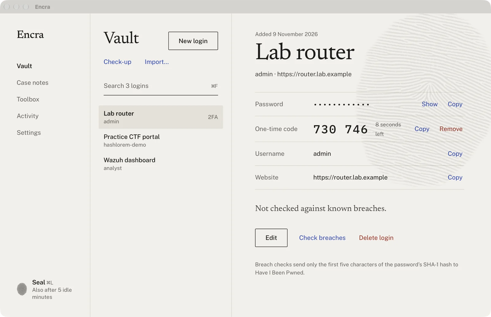

# Encra

Encra is a desktop app for the passwords, 2FA codes, case notes and evidence files a security practitioner works with, kept in one encrypted file on their own machine. It also has a few everyday tools and a log of everything that touched the vault. There is no account, no sync and no telemetry. The only network request it makes is the Have I Been Pwned range query, and that one comes from Rust, not the window.



I started it as a password manager for my own lab logins, audited it, didn't like what I found, and rebuilt the storage. That audit is in [SECURITY-AUDIT.md](SECURITY-AUDIT.md), and a second review with its current status is in [docs/architecture-review.md](docs/architecture-review.md).

## What's in it

**Vault.** Logins with password, username, website, notes and an optional TOTP secret (6 to 8 digits, 10 to 300 seconds, SHA-1, SHA-256 or SHA-512). A 2FA secret can be added from a setup key, an `otpauth://` link, or a screenshot of the QR code, which Rust decodes so the image never reaches the page. A check-up lists reused, weak, old and breached passwords. Logins can be imported from Apple Passwords, Bitwarden, 1Password, Firefox and generic CSV exports, with a preview first and an offer to delete the export afterwards.

**Cases.** One notebook per investigation, with entries typed as notes, findings, recon and so on, each with a severity. Every case has four tabs:

- *Evidence*: files are hashed on intake (SHA-256, SHA-1, MD5), stored encrypted in 1 MiB chunks, and get their own chain-of-custody record. Verify re-hashes the stored copy; Export writes a copy and checks it. The originals are never modified.
- *Indicators*: domains, URLs, IPs, emails, hashes and CVEs pulled from the case description, the notes and the evidence file names, shown defanged by default, with copy and CSV export.
- *Timeline*: the case, its notes and every custody event in the order they happened.
- *Notes*: the entries themselves, printable as a report.

**Toolbox.** A password generator, an Nmap XML parser that can file hosts into a case, and a library of commands you trust with notes on when to use them.

**Activity.** Unlocks, failed unlocks, seals, imports, backups and evidence events, readable while the vault is sealed. It never records a value or a login name.

**`encra run`.** A script or an AI agent can use a login without seeing it. The command asks for references such as `encra://GitHub#password`, I approve the request in Encra, and the values go straight into the environment of the program being run. It is off by default and every request needs a click.

```console
$ encra run --name deploy-script --env GITHUB_TOKEN=encra://GitHub#password -- ./deploy.sh
```

## How the data is protected

The master password never encrypts anything directly. A random 256-bit data key encrypts the vault, and that key is stored only in wrapped form, sealed with AES-256-GCM under a key derived from the password with Argon2id (256 MiB, 3 passes, 1 lane, about 320 ms on an M5). The Argon2 settings are stored with the vault and with every backup, so they can be raised later. Eight one-time recovery codes each wrap the same data key, so a forgotten password costs a recovery code, not the vault.

Every stored field is sealed separately with AES-256-GCM, using `encra:v1:<table>:<id>:<column>` as associated data. Someone with the database file can't swap two ciphertexts, for example the passwords of two logins, because a value moved to another row or column fails to decrypt. Login and case names are encrypted too and sorted in Rust after decryption.

Secrets stay in Rust. The list the window shows carries names and metadata only. Showing, copying or reading a 2FA code is a single-purpose command for one field of one login. Copying happens in Rust: the clipboard item is marked `org.nspasteboard.ConcealedType` so clipboard managers skip it, and it is cleared after 30 seconds or when the vault seals, but only if the clipboard still holds Encra's value. The webview has no file system, dialog or shell access; files are picked in dialogs opened from Rust, or dropped on the window and claimed by Rust. The content security policy allows only the app's own scripts, styles and fonts, with no inline styles.

The activity log is chained with HMAC-SHA256 under a key derived from the vault key. Editing, deleting or reordering an entry breaks the chain, and the Activity page says where. Entries written while sealed join the chain at the next unlock.

The vault seals on a shortcut, after five idle minutes, and optionally when Encra loses focus. The database folder is `0700` and its files `0600`, and SQLite's `secure_delete` is on so old pages don't linger.

For `encra run`, the socket is private to the current user, Encra checks that the caller has the same user ID and that its executable hashes to the same SHA-256 as Encra's own binary, requests expire after 120 seconds, and the approval dialog shows the command, its folder, its parent processes and which login each reference matched. Inline scripts (`sh -c`, `python -c`) and requests for a password together with its 2FA code are flagged in red.

## Building it

You need Rust (stable), Node.js and the [Tauri 2 prerequisites](https://v2.tauri.app/start/prerequisites/) for your platform.

```console
$ npm install
$ npm run tauri dev      # debug build, uses a separate test vault
$ npm run tauri build    # release build
```

Debug builds never open the real vault. Set `ENCRA_DATA_DIR` to choose where the test vault lives.

## Tests

```console
$ cd src-tauri && cargo test
$ npx tsc --noEmit
```

The Rust suite has 112 tests, plus 3 ignored by default: two that call the live Have I Been Pwned API and a 50,000-entry activity log benchmark. The tests run against real SQLite files and close and reopen them wherever persistence matters. They cover the vault format migrations and their rollback, a forced failure in the middle of a recovery reset, tampering with the activity chain, backups restored into a different vault, the full `encra run` flow over a real socket (approve, deny, timeout, disconnect, seal), the RFC 6238 test vectors, QR decoding from real images, and evidence files at every size around a chunk boundary, including tampered copies and a crash during intake.

## Limits

- Built and tested on macOS only. Tauri should build it for Linux and Windows, but I haven't tried, and the concealed-clipboard marker is macOS-specific.
- The app is not code-signed. Without a signature and the hardened runtime, another program running as the same user could inject code into the `encra run` client.
- Approving an `encra run` request trusts the program as it is right now. If that program prints the value, whoever is watching its output sees it.
- Unlocking checks an Argon2 password hash and then derives the wrapping key, so it runs Argon2 twice. Using the wrapped key's GCM tag as the only check would halve that; it's still undecided.
- Encra protects a vault file at rest and keeps secrets out of the window. It can't protect a machine that is already compromised while the vault is open.

## Licence

MIT. See [LICENSE](LICENSE).
